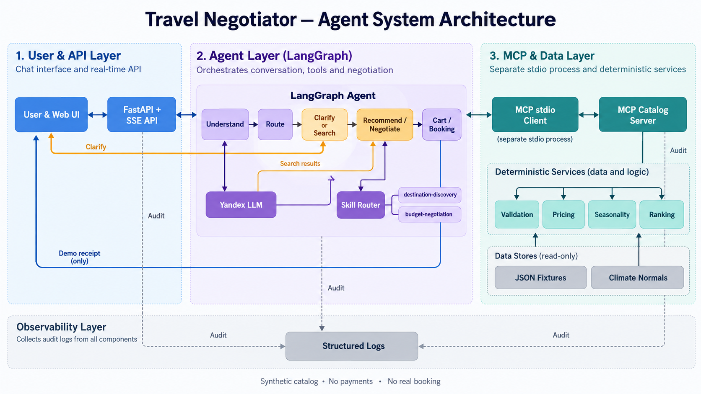

# Travel Negotiator

Демонстрационный AI-агент для планирования поездок. Агент извлекает условия
из сообщения, запрашивает недостающие данные, ищет варианты в синтетическом
каталоге, ранжирует их и объясняет возможные компромиссы.

Все предложения, цены, расписания, доступность и бронирования в проекте
синтетические. Приложение не выполняет оплату и не создает реальную бронь.

## Архитектура



Основной поток проходит от веб-интерфейса через FastAPI и LangGraph к отдельному
MCP-процессу каталога. Расчёт цен, валидация, сезонность и ранжирование остаются
детерминированными, а LLM и Skills используются только на подходящих этапах.

## Быстрый запуск

Требуются Docker Engine и Docker Compose.

1. Скопируйте `.env.example` в `.env`.
2. Заполните `YANDEX_API_KEY` и `YANDEX_FOLDER_ID`.
3. Запустите приложение:

```powershell
docker compose up --build
```

Интерфейс будет доступен по адресу <http://localhost:8080>.

Для запуска в фоне и просмотра логов:

```powershell
docker compose up --build -d
docker compose logs -f app
```

Остановка:

```powershell
docker compose down
```

## Настройки

- `YANDEX_API_KEY` — ключ Yandex Cloud AI Studio.
- `YANDEX_FOLDER_ID` — идентификатор каталога Yandex Cloud.
- `YANDEX_MODEL` — модель; по умолчанию `deepseek-v4.1-flash`.
- `YANDEX_BASE_URL` — адрес OpenAI-совместимого API Yandex Cloud.
- `TN_SEASONALITY_PROVIDER=openmeteo` — использует локальный климатический
  кэш Open-Meteo.
- `TN_LOG_USER_MESSAGES=1` — включает текст пользователя в диагностических
  логах. В Compose по умолчанию установлено `0`, поэтому текст скрыт.

Основной каталог всегда содержит 15 направлений. Compose включает провайдер
Open-Meteo, а переменные явно передаются дочерним MCP-процессам.

## Как устроена обработка запроса

1. FastAPI принимает сообщение через SSE API.
2. LangGraph восстанавливает состояние диалога.
3. Детерминированные правила и LLM формируют валидированное изменение
   `TripRequest`.
4. Если обязательных данных недостаточно, агент задает один уточняющий вопрос.
5. Каталог запускается отдельным MCP-процессом и проверяет ограничения.
6. Допустимые предложения получают оценку соответствия и сортируются.
7. Skill Router при необходимости подключает специализированную инструкцию.
8. Пользователь может выбрать вариант или явно согласовать компромисс.
9. Подтверждение бронирования создает только демонстрационную квитанцию.

Основные каталоги проекта:

- `app/agent/` — разбор намерения, LangGraph и состояние диалога;
- `app/agent/skills/` — загружаемые инструкции и детерминированный Skill Router;
- `app/schemas/` — Pydantic-модели и перечисления контрактов;
- `app/constants/` — промпты, шаблоны уточнений и правила распознавания;
- `app/commands/` — ручное обслуживание климатического кэша и снимков;
- `app/mcp_catalog/` — MCP-сервер и публичные контракты каталога;
- `app/data/` — синтетические направления, профили и цены;
- `app/services/` — валидация, ранжирование и сезонность;
- `app/web/` — FastAPI, SSE и статический интерфейс.

Справочники каталога находятся в `app/data/fixtures/*.json` и валидируются
Pydantic-моделями из `app/data/loader.py`. Базовые адреса, таймауты и лимиты
находятся в `configs/settings.toml`.
Секреты и настройки окружения из `.env` имеют приоритет над TOML.

Гибкий период ограничен 31 днем. Поиск проверяет каждую дату внутри периода.
Жесткие ограничения не ослабляются без явного согласия пользователя.

## Skills

Агент загружает инструкции из `SKILL.md` только для подходящего сценария:

- `destination-discovery` — сравнивает направления, если место поездки не выбрано;
- `budget-negotiation` — объясняет подтверждённый ценовой разрыв и компромиссы.

Router выбирает навык по валидированному состоянию без дополнительного LLM-вызова.
Навыки не рассчитывают цены, не проверяют доступность и не меняют запрос. Эти
операции остаются в Python и MCP. Выбранный навык присутствует в поле
`active_skill` ответа API и в событии журнала `agent.skill.selected`.

## API

- `GET /` — веб-интерфейс;
- `GET /health` и `GET /api/health` — проверка состояния;
- `POST /api/chat` — обычный JSON-ответ;
- `POST /api/chat/stream` — события `progress`, затем `result` или `error`;
- `GET /api/catalog/history` — исторические наблюдения, не доступные для
  бронирования.

API возвращает `X-Request-ID`. Структурированные JSON-логи содержат тот же
`request_id` и `session_id`, поэтому по ним можно восстановить полный путь
сообщения: разбор, маршрутизацию, уточнение, MCP-поиск, ранжирование и ответ.
Ключи API и внутренние рассуждения модели не логируются.

## Данные и сезонность

Синтетический каталог создается детерминированно из профилей в `app/data/`.
Тип источника каждого предложения — `synthetic`. Даже вариант с прямым рейсом
не подтверждает существование такого рейса в реальном расписании.

`OpenMeteoSeasonalityProvider` читает локальный файл
`app/data/fixtures/climate_normals.json` и не обращается к сети во время чата.
Обновить климатический кэш можно командой:

```powershell
uv run python -m app.commands.refresh_climate_cache --start-year 2022 --end-year 2025
```

Климатические значения являются историческими средними, а не прогнозом.
Источник данных: Open-Meteo и указанные им поставщики Copernicus/ECMWF.

Исторические наблюдения цен импортируются отдельно:

```powershell
uv run python -m app.commands.import_offer_snapshots путь\к\файлу.json
```

Формат показан в `app/data/snapshot_example.json`. Для каждой записи нужны
источник, время наблюдения, отель, даты поездки и состав гостей. Исторические
записи не участвуют в демонстрационном бронировании.

## Проверки

Установка зависимостей и полный набор тестов:

```powershell
uv sync --frozen --group dev
uv run python -m pytest -q
```

Проверка покрытия с обязательным порогом 75%:

```powershell
uv run coverage run -m pytest -q
uv run coverage report
```

Проверка MCP-каталога:

```powershell
uv run python -m app.mcp_catalog.smoke
```

Файлы `.env` и другие секреты нельзя добавлять в репозиторий.


## Скринкаст

Ссылка на яндекс диск: https://disk.360.yandex.ru/i/__kpVSgh3Dr1aA

Ссылка на google drive: https://drive.google.com/file/d/1qQZ3MYfhWAMGde9dFUSJTUhTIk54dJ5j/view?usp=sharing
